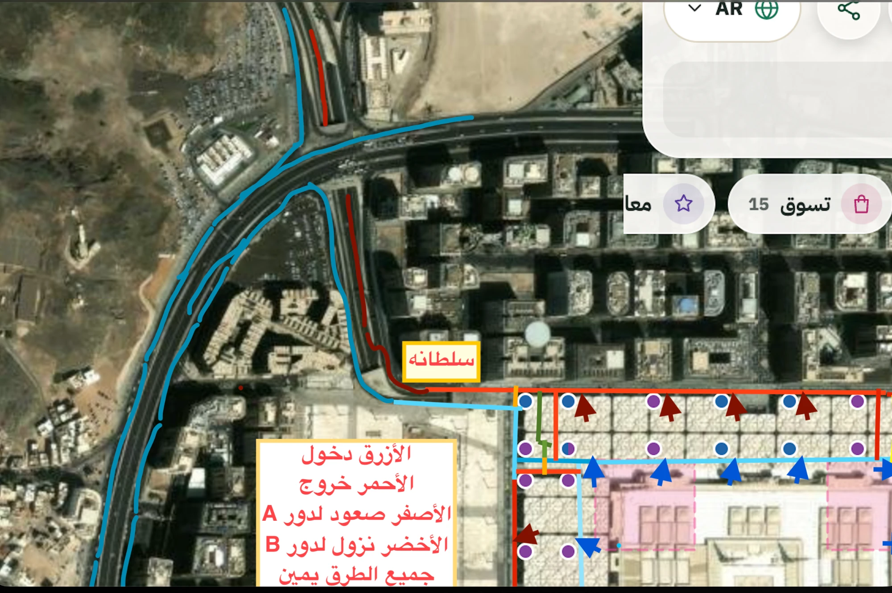
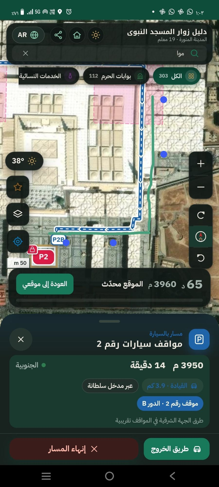
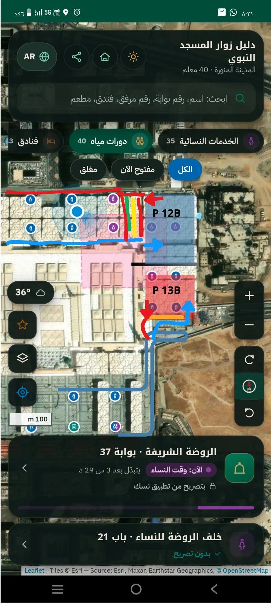
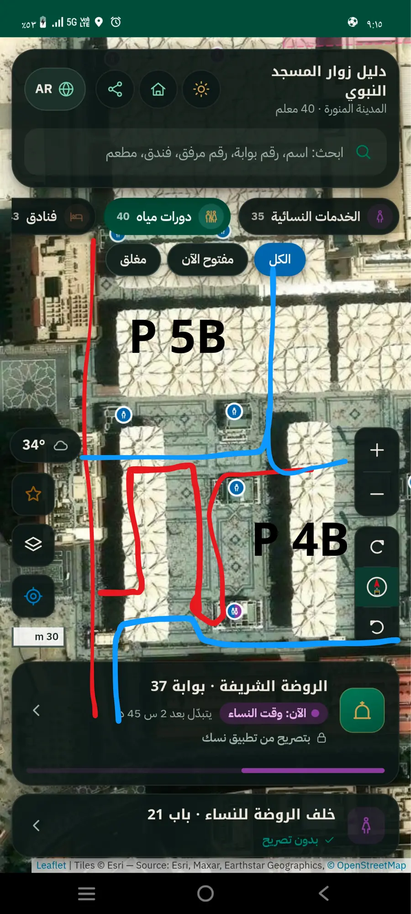

# طرق المواقف تحت الساحات (رسم المالك 2026-10-13)


## 1) ما في الرسم
| اللون | المعنى | في البيانات |
|---|---|---|
| الأزرق | طرق الدخول | `kind: entry` |
| الأحمر | طرق الخروج | `kind: exit` |
| الأصفر | صعود للدور A (شمال شرق) | `ramp_up` |
| الأخضر | نزول للدور B (شمال غرب) | `ramp_down` |
| البرتقالي | جزء مشترك | `shared` |

- **المدخلان:** قباء في الجنوب الغربي، وسلطانة في الشمال الغربي (يُوصل إليه من طريق السلام). كلاهما يطابق مدخل مواقف مسجّلاً في OpenStreetMap (`amenity=parking_entrance`)، والدخول جنوب الخروج عند سلطانة، وشرقه عند قباء، كما في الرسم.
- **المخرجان:** سلطانة شمالاً، وقباء جنوباً (الأهم).
- **اتجاه واحد (بتأكيد المالك):** كل طريق باتجاه واحد بترتيب نقاطه، ولا يُسمح بعكس الشارع. «جميع الطرق يمين» تعني أن الحركة تدور يميناً، أي مع عقارب الساعة: شرقاً في الشمال، وجنوباً في الشرق، وغرباً في الجنوب، وشمالاً في الغرب.
- **الدوران:**
  - الطرق نفسها في الدورين: **B** السفلي و**A** العلوي.
  - الدخول والخروج الرئيسيان من **B فقط**.
  - الصعود إلى A بالأصفر بعد موقف 11، والنزول إلى B بالأخضر بين المرفقين 220 و222.
  - **في الدور A (بتصحيح المالك):**
    - بعد الطلعة الصفراء تتجه السيارة غرباً على الطريق الشمالي. منه تدخل **المواقف الشمالية** (عكس B)، وتخرج منها إلى الطريق الشمالي الداخلي.
    - **المواقف الغربية والجنوبية والشرقية** كما في B، فيلزم ما يقارب دورة كاملة: من الركن الشمالي الغربي نزولاً إلى طريق الخروج الغربي، ثم الوصلة الزرقاء إلى الحلقة، ثم مع عقارب الساعة.
    - **وصلة الركن الشمالي الغربي في A** (`a-nw-corner`) استنتاج من هذا الوصف، لأن الرسم لا يفرّق بين الدورين. تُصحَّح إن لم تكن كذلك.
- **البرتقالي:** في الدور **B فقط**. فتحة بين مسار الدخول ومسار الخروج لمن غيّر رأيه، تُعبر في الاتجاهين، وليس طريقاً للنزول.
- **الوصلة الزرقاء في الغرب** (عند المرفقين 211 و212): باتجاه واحد من طريق الخروج الغربي إلى الحلقة، بدل الذهاب إلى المواقف الجنوبية وأخذ لفة كاملة.
- **خروج المواقف الجنوبية:** إلى الطريق السفلي شرقاً، ثم شمالاً إلى الخروج الأحمر في الجهة الشرقية (بتأكيد المالك).
- **المواقف الـ13:** كل سهم أزرق مدخل موقف، وكل سهم أحمر داكن مخرجه. المدخل في بداية الموقف بعد أول مرفق مباشرة.
- **داخل الموقف:** 4 صفوف للركن، صفّان في المنتصف يفصلهما رصيف طولي صغير، وصف في كل جانب، وممرات تسمح بحرية الحركة. **المسار ينتهي عند مدخل الموقف ولا يُرسم داخله**، لأن الزائر يركن حيث يشاء (بطلب المالك 2026-10-13). وطريق الخروج يبدأ من مخرج الموقف.

## 1-ب) جهة سلطانة بالتفصيل (رسم المالك الثاني، 2026-10-13)


- **الدخول (أزرق):**
  - كل سيارة تدخل من سلطانة تمر بالطريق الموازي للدائري متجهة شمالاً، ثم تلتف في الحلقة عند التقاطع، ثم تنزل جنوباً على منحدر الدخول حتى فم المواقف. هناك يبدأ الطريق تحت الأرض.
  - القادم من الشمال أو الشرق يكمل جنوباً على الدائري، ثم يعود شمالاً على الطريق الموازي، كما في الخطين الأزرقين الخارجي والداخلي.
- **الخروج (أحمر):** من الركن الشمالي الغربي صعوداً على منحدر الخروج، ثم شمالاً على طريق سلطانة. بين نهاية المنحدر وطريق سلطانة لا يوجد خط في الرسم عند التقاطع، فوُصلا بخط مستقيم.
- **المعايرة:** على 16 مرفقاً ظاهراً في الرسم، الخطأ أقصاه 1.04 م. نهاية طريق الدخول تقع على بعد 4.9 م من بداية الطريق تحت الأرض في الرسم الأول، فالرسمان متطابقان.
- **التطابق مع الطرق:** اتجاه كل طريق باتجاه واحد في OpenStreetMap حول الحلقة والمنحدر يطابق أسهم الرسم.
- **في التطبيق:**
  - تُوجَّه السيارة في الشوارع إلى طريق الدخول المرسوم. تدخله من أي نقطة منه بشرط أن تكون على الطريق الذاهب في اتجاهه نفسه.
  - لا تدخله في آخر جزء قرب فم المواقف، فلا يأتي المسار من الشارع الجانبي الغربي.
  - طريق الدخول يُرسم جزءاً من القيادة فوق الأرض.
- **البيانات:** نقاط الرسم في [garage-sultana-2026-10-13.json](garage-sultana-2026-10-13.json)، ويبنيها السكربت نفسه (`extra_drawings`).

## 2) من الرسم إلى البيانات
1. **المعايرة:** على علامات المرافق الـ36 (201–236) الظاهرة في الرسم، بمواقعها بعد `data/overrides.json`. الخطأ أقصاه 1.5 م ومتوسطه 0.65 م.
2. **الخطوط:** قيست من ألوانها في الصورة، والنقاط بالبكسل في [garage-2026-10-13.json](garage-2026-10-13.json).
3. **المسجد:** المواقف تحت الساحات لا تحت المسجد. أي طريق يقع على مستطيل المسجد يُزاح إلى أقرب جانب منه بـ5 م، ويلتف عند الزاوية. حدث هذا في الطريق الشرقي فقط: 129 نقطة، أبعدها 11.7 م.
4. **البناء:**
   ```
   python3 scripts/garage-from-drawing.py docs/routes/garage-2026-10-13.json
   ```
   يكتب `data/garage.json`. لا يُعدَّل باليد.

## 3) كيف يُرسم مسار السيارة (`src/routing/garage.ts`، `src/routing/plan.ts`)
0. **أي موقف:**
   - الوجهة نفسها إن كانت موقفاً.
   - أو اختيار المالك (`rules.json` → `drive_lot`): الروضة باب 37 ← موقف 1، وباب 21 ومدخل خلف الروضة ← موقف 9.
   - أو **أقرب موقف عام للوجهة مشياً** من درجه. لا تُختار مواقف المشتركين (2، 6، 8، 10).
1. **الشوارع:** القيادة إلى منحدر الدخول، قباء أو سلطانة. يُجرَّب المدخلان ويُختار الأسرع.
2. **طرق المواقف:**
   - الدوران شبكة واحدة موجّهة: كل طريق في كل دور، والمنحدران بينهما.
   - أقصر طريق بالاتجاهات الإجبارية إلى نقطة دخول الموقف (السهم) في الدور الذي اختاره الزائر.
   - زر **الدور B / A** في البطاقة، ويُحفظ الاختيار.
3. **نهاية القيادة:** عند **مدخل الموقف**، على حافته بعد أول مرفق.
4. **المشي:** يبدأ من الدرج، أي المرفق الأقرب للوجهة من مرافق الموقف الأربعة، إلى الوجهة.
5. **على الخريطة:**
   - علامة **P** عند منحدر الدخول، وعلامة **P9** مثلاً حيث يدخل الموقف.
   - المسار تحت الأرض خط أزرق بشرطات بيضاء.
6. **في البطاقة:** «عبر مدخل قباء/سلطانة» ورقم الموقف والدور. وعلى الخريطة علامة **↑A** عند الصعود، و**↓B** عند النزول.
7. **تمييز الدور A:**
   - المسار في الدور A له **إطار أصفر** بلون الطلعة الصفراء، وعليه لافتة «الدور A».
   - المنحدر إطاره أصفر للصعود وأخضر للنزول.
   - في الدور B يبقى الإطار أبيض.
   - في البطاقة سطر «الإطار الأصفر: الطريق في الدور A».
8. **طريق الخروج:**
   - زر **«طريق الخروج»** في بطاقة المسار إلى موقف.
   - يرسم الطريق من **مخرج الموقف** (السهم الأحمر) على طرق الخروج بالاتجاهات الإجبارية.
   - من الدور A يكون عبر إحدى النزلتين الخضراوين.
   - ينتهي عند مخرج قباء (الأهم) أو سلطانة. يُعرض الأسرع، والآخر بديلاً باهتاً إن كان ضمن 30%.
   - من سلطانة يكمل شمالاً على طريق سلطانة كما رُسم.
   - تحت الأرض لا يعمل GPS، لذلك يُعرض طريق الخروج ولا يُتابَع حياً.
   - زر **«طريق الدخول»** يعيد طريق الدخول.
9. **الطرق غير المؤكدة:** إن مرّ المسار بطريق معلّم `"certain": false` ظهرت ملاحظة «تقريبية». لا يوجد الآن طريق كهذا.

## 4) تعديل الجهة الشرقية بسرعة
صارت الجهة الشرقية كلها **مؤكدة** بتصحيح المالك (2026-10-14، القسم 4-ج). لا يوجد طريق معلّم `"certain": false`، فلا تظهر ملاحظة «تقريبية». إن عاد شيء غير مؤكد:

1. **عدّل النقاط:** في `garage-2026-10-13.json` عدّل نقاط الطريق بالبكسل على الرسم نفسه. أو أرسل رسماً جديداً، فتُستخرج منه الخطوط بالطريقة نفسها.
2. **أعد البناء:** شغّل أمر البناء أعلاه.
3. **اختبر:**
   ```
   npm test
   ```
   الاختبار يتحقق أن كل موقف يُصل إليه من المدخلين، وأن لا طريق تحت المسجد أو البقيع.
4. **علّم غير المؤكد:** اجعل `"certain": false` على الطريق فتظهر الملاحظة.

## 4-ب) تصحيح المالك: الطرق قريبة من المرافق لا من المسجد (2026-10-13)


- **المعايرة:**
  - رسم المالك بالأخضر على لقطة من التطبيق مكان الطريق الصحيح.
  - الدوائر الزرقاء في اللقطة رسمها المالك ليشير إلى المرافق، فليست علامات التطبيق، لذلك لم تُستعمل للمعايرة.
  - عوضاً عنها عُويرت اللقطة على المسار المرسوم فيها وعلى علامتي P2B وP2: نحو 0.51 م لكل بكسل.
- **الطريق الشرقي:**
  - صار بجانب المرافق الشرقية (x≈225–232 م، والمرافق عند 235 م)، بدل 195–208 م ملاصقاً للمسجد.
  - تحت التقاطع يسير بجانب طريق دخول قباء الصاعد، بمسافة 4 م بينهما وباتجاهين متعاكسين.
  - الوصلة البرتقالية تصل بينهما.
- **الطريق الجنوبي:**
  - أُزيح 8 م جنوباً بطوله، بجانب صف المرافق الجنوبي.
  - النتيجة: صارت أسهم دخول المواقف 1 و2 في الرسم الأول على بعد 1 م منه، بعد أن كانت على بعد 9 م.
- **اختبار دائم:** الطريقان الشرقي والجنوبي أقرب إلى المرافق منهما إلى جدار المسجد.

## 4-ج) تصحيح المالك بعد زيارة الموقع (2026-10-14)
 

عُويرت اللقطتان على علامات المرافق الظاهرة فيهما (16 و4 مرافق، الخطأ أقل من 3 بكسل). ثم حُوّلت النقاط إلى بكسل الرسم الأول، فبقي `garage-2026-10-13.json` المصدر الوحيد.

- **الجهة الشرقية مقطوعة بين 12B و13B** (الخط الأسود). الطريق الشمالي لا يكمل شرقاً ثم جنوباً، وحُذف الخروج الشرقي الصاعد إلى الشمال.
- **موقف 12:**
  - الدخول من نهاية الطريق الشمالي الداخلي (السهم الأزرق).
  - الخروج شمالاً إلى طريق الخروج الشمالي، الذي صار يبدأ شرق الموقف، ثم غرباً (السهم الأحمر).
  - وصلة حمراء من نهاية الطريق الداخلي إلى طريق الخروج، شرق الطلعة الصفراء.
- **النزول الأخضر الثاني** بجانب الطلعة الصفراء من جهة الغرب (`ramp-down-B-east`):
  - يبدأ من الطريق الداخلي في الدور A، ويتجه شمالاً إلى طريق الخروج في الدور B، ثم إلى مخرج سلطانة.
  - صار الخروج من المواقف الشمالية في الدور A منه.
- **موقف 13:**
  - الدخول من الجنوب: طريق دخول قباء يصعد شمالاً، ثم شرقاً تحت الموقف، ثم شمالاً إلى السهم الأزرق في جهته الشرقية.
  - الخروج من جهته الغربية جنوباً على الطريق الشرقي، ثم غرباً على الطريق الجنوبي.
  - الطريقان طريق واحد باتجاهين لا يفصلهما شيء (قول المالك): الأحمر غرباً والأزرق شرقاً، بين خطّيهما 4.5 م. لا يُقرَّبان أكثر، لأن نهاية أحدهما إذا كانت على أقل من 4 م من الآخر تتصل به، فيصير فيها دوران للخلف. والبقيع يبدأ شرقاً عند x≈230 م.
- **البرتقالي تحت موقف 13 (`se-shared`):**
  - لمن أراد الدخول ثم وجد الموقف للمشتركين، فيعود إلى الطريق الشرقي. يُعبر في الاتجاهين.
  - هو أيضاً طريق القادم من قباء إلى المواقف 1–4.
  - في الدورين A وB (بتأكيد المالك). وبه يُوصل إلى المواقف 1–4 و13 في الدور A.
- **من سلطانة إلى المواقف 1–4** (قول المالك):
  - يتجه جنوباً مباشرة إلى آخر الطريق الغربي، كأنه يريد مخرج قباء.
  - عند المخرج ينعطف يساراً إلى طريق الدخول الجنوبي (`sw-turn`)، ثم يكمل كالقادم من قباء.
- **بين 4B و5B:**
  - طريق الخروج الجنوبي الغربي يسير غرباً، ثم ينزل جنوباً بجانب 4B، ثم يلتف ويصعد شمالاً.
  - ثم يسير غرباً فوق الكتلة، وينزل جنوباً، ويتجه غرباً حتى ينضم إلى طريق الخروج الطويل إلى مخرج قباء.
  - من أسفل الالتفاف وصلة إلى طريق الدخول (`sw-back-in`)، لمن أراد العودة إلى المواقف 1–4 بدل الخروج.
  - **إصلاح:** هذا الطريق كان يبدأ على بعد 1.9 م من الطريق الجنوبي فلم يكن متصلاً به، فكان الخروج الجنوبي يدور من الشمال. صار يبدأ على نقطة من الطريق الجنوبي نفسه.
- **الدور A:** مثل B تماماً، إلا أنه لا دخول ولا خروج فيه إلى خارج المواقف عند قباء.

## 4-د) سيارة داخل المواقف أصلاً (2026-10-14)
- **ما رآه المالك:** كان قرب الطلعة الصفراء وطلب موقف 12A، فأخرجه التطبيق إلى الشارع ثم أدخله من مدخل سلطانة من جديد.
- **السبب:** مسار السيارة كان يبدأ دائماً من الشوارع.
- **الآن:**
  - إن كانت السيارة على بعد 20 م أو أقل من أحد طرق المواقف، يبدأ المسار من مكانها على ذلك الطريق، في اتجاهه وفي الدور B.
  - بعدها يسير على الطرق باتجاهاتها الإجبارية، وللدور A يصعد بالطلعة الصفراء مباشرة.
  - لا تظهر علامة P عند المدخل، ولا سطر «عبر مدخل…».
- **الطريقان المتجاوران:** حيث يسير طريقا الدخول والخروج جنباً إلى جنب، يُختار الطريق الذي يوافق اتجاه سير السيارة إن كان معروفاً.
- **الكود:** `garageRouteFrom` في `src/routing/garage.ts`، و`planDrive` في `src/routing/plan.ts`.

## 4-هـ) سؤال الزائر: أين سيارتك؟ (طلب المالك 2026-10-14)
يظهر عند طلب مسار بالسيارة إذا كان الموقع داخل المواقف أو قريباً منها: على بعد 30 م أو أقل من أحد طرقها، أو داخل موقف أو بجانبه. في الخارج لا يظهر.

1. **«هل أنت داخل موقف n؟»** (n أقرب موقف إلى الموقع). الخيارات:
   - «نعم، داخل موقف n»
   - «داخل موقف m» (ثاني أقرب موقف)
   - «لا، أنا على الطريق»
   - «أنا خارج المواقف»: إضافة لم يطلبها المالك، لمن كان فوق الأرض قريباً من المواقف.
2. **«في أي دور أنت؟»** الدور B أو الدور A. لا يُسأل لمن اختار «خارج المواقف».

- **داخل موقف:** يبدأ المسار من مخرج ذلك الموقف في الدور المختار (خطوة «اخرج من الموقف»). وإن كان هو الموقف المطلوب نفسه وفي الدور نفسه، يبقى المشي فقط.
- **على الطريق:** يبدأ المسار من أقرب طريق في الدور المختار، في اتجاهه.
- **خارج المواقف:** كما كان، من الشوارع عبر أحد المدخلين.
- **حفظ الجواب:** يبقى 10 دقائق، فلا يُعاد السؤال عند تغيير الدور أو إعادة الرسم من المكان نفسه. عند إعادة حساب المسار أثناء السير، يبدأ من الطريق في الدور نفسه، لأن السيارة تحركت.
- **إلغاء:** زر Esc يلغي طلب المسار.
- **الكود:** `src/ui/garage-ask.ts` (الواجهة)، و`lotsToAsk` و`GarageStart` في `plan.ts`، و`garageRouteFromLot` و`nearGarage` في `garage.ts`.

## 5) ما لم يُستعمل بعد
الوصلة البرتقالية الصغيرة بين طريق الخروج الشمالي وطريق سلطانة عند الركن الشمالي الغربي مستعملة في الدورين. أما مخرج قباء فلم يُرسم بعده طريق فوق الأرض، فينتهي طريق الخروج عند مدخل المواقف المسجّل في OpenStreetMap.
