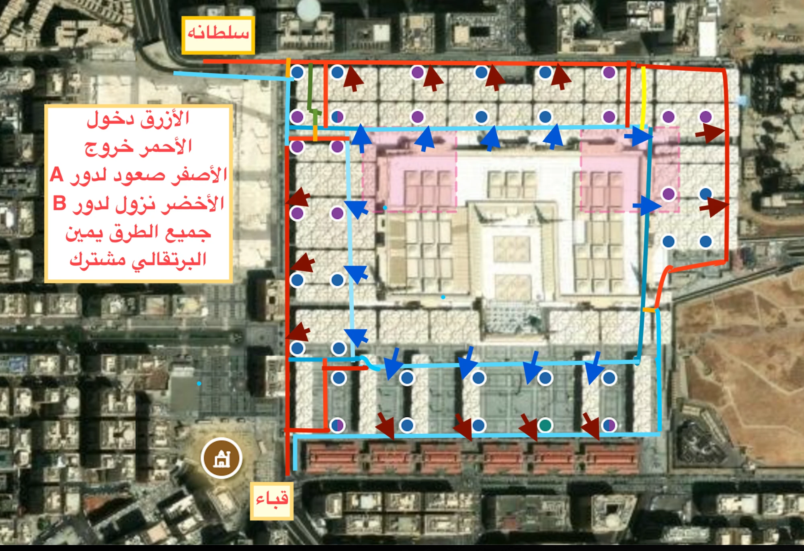

# طرق المواقف تحت الساحات (رسم المالك 2026-10-13)



## 1) ما في الرسم
| اللون | المعنى | في البيانات |
|---|---|---|
| الأزرق | طرق الدخول | `kind: entry` |
| الأحمر | طرق الخروج | `kind: exit` |
| الأصفر | صعود للدور A (شمال شرق) | `ramp_up` |
| الأخضر | نزول للدور B (شمال غرب) | `ramp_down` |
| البرتقالي | جزء مشترك | `shared` |

- **المدخلان:** قباء في الجنوب الغربي، وسلطانة في الشمال الغربي (يُوصل إليه من طريق السلام). كلاهما يطابق مدخل مواقف مسجّلاً في OpenStreetMap (`amenity=parking_entrance`)، والدخول جنوب الخروج عند سلطانة، وشرقه عند قباء، كما في الرسم.
- **المخرجان:** سلطانة شمالاً، وقباء جنوباً (الأهم).
- **«جميع الطرق يمين»:** كل طريق باتجاهين والقيادة على اليمين، فيُرسم المسار على يمين الطريق (2.5 م من منتصفه).
- **المواقف الـ13:** كل سهم أزرق مدخل موقف، وكل سهم أحمر داكن مخرجه. المدخل في بداية الموقف بعد أول مرفق مباشرة.
- **داخل الموقف:** 4 صفوف للركن، صفّان في المنتصف يفصلهما رصيف طولي صغير، وصف في كل جانب. بينها ممرّان على ربع العرض من كل جانب طويل.

## 2) من الرسم إلى البيانات
1. **المعايرة:** على علامات المرافق الـ36 (201–236) الظاهرة في الرسم، بمواقعها بعد `data/overrides.json`. الخطأ أقصاه 1.5 م ومتوسطه 0.65 م.
2. **الخطوط:** قيست من ألوانها في الصورة، والنقاط بالبكسل في [garage-2026-10-13.json](garage-2026-10-13.json).
3. **المسجد:** المواقف تحت الساحات لا تحت المسجد. أي طريق يقع على مستطيل المسجد يُزاح إلى أقرب جانب منه بـ5 م، ويلتف عند الزاوية. حدث هذا في الطريق الشرقي فقط: 129 نقطة، أبعدها 11.7 م.
4. **البناء:**
   ```
   python3 scripts/garage-from-drawing.py docs/routes/garage-2026-10-13.json
   ```
   يكتب `data/garage.json`. لا يُعدَّل باليد.

## 3) كيف يُرسم مسار السيارة (`src/routing/garage.ts`، `src/routing/plan.ts`)
1. **الشوارع:** القيادة إلى منحدر الدخول، قباء أو سلطانة. يُجرَّب المدخلان ويُختار الأسرع.
2. **طرق المواقف:** طرق الدخول شبكة واحدة باتجاهين، وأقصر طريق إلى نقطة دخول الموقف (السهم).
3. **داخل الموقف:** من حافته عند المدخل، ثم إلى الممر في جهة الدرج الذي سيُصعد منه، ثم إلى أقرب موقف سيارة له.
4. **الصعود والمشي:** الدرج هو المرفق الأقرب للوجهة من مرافق الموقف الأربعة، ثم المشي إلى الوجهة.
5. **على الخريطة:**
   - علامة **P** عند منحدر الدخول، وعلامة **P9** مثلاً حيث يدخل الموقف.
   - المسار تحت الأرض خط أزرق بشرطات بيضاء.
6. **في البطاقة:** «عبر مدخل قباء/سلطانة» ورقم الموقف.
7. **الجهة الشرقية:** إن مرّ المسار بها ظهرت ملاحظة «طرق الجهة الشرقية في المواقف تقريبية».

## 4) تعديل الجهة الشرقية بسرعة
الجهة الشرقية معلّمة `"certain": false`، وهي: الطريق الشرقي، والوصلة المشتركة جنوب شرق، والخروج الشرقي، والصعود للدور A، والموقفان 12 و13.

1. **عدّل النقاط:** في `garage-2026-10-13.json` عدّل نقاط الطريق بالبكسل على الرسم نفسه. أو أرسل رسماً جديداً، فتُستخرج منه الخطوط بالطريقة نفسها.
2. **أعد البناء:** شغّل أمر البناء أعلاه.
3. **اختبر:**
   ```
   npm test
   ```
   الاختبار يتحقق أن كل موقف يُصل إليه من المدخلين، وأن لا طريق تحت المسجد أو البقيع.
4. **حين تتأكد:** اجعل `"certain": true` فتختفي الملاحظة.

## 5) ما لم يُستعمل بعد
طرق الخروج ومخارج المواقف والصعود والنزول بين الدورين مسجّلة في البيانات. لكن التطبيق يرسم حالياً **طريق الوصول** فقط، لا طريق الخروج بعد الركن.
