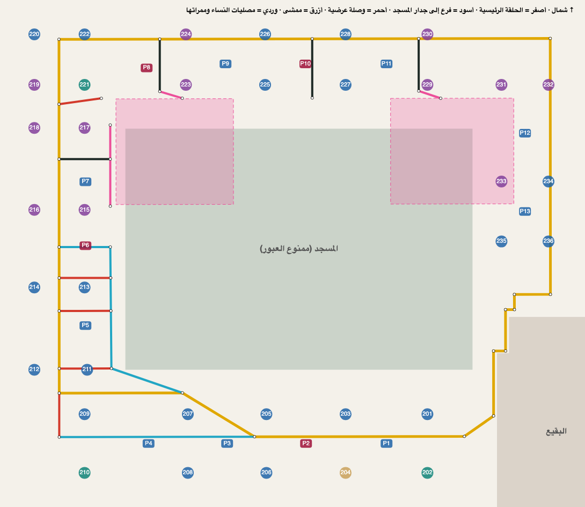

# شبكة المسارات (v2، حسب رسم المالك 2026-10-08)

- **الرسم الأصلي:** [owner-drawing-2026-10-08.webp](owner-drawing-2026-10-08.webp) و[owner-drawing-2026-10-08-lines.png](owner-drawing-2026-10-08-lines.png).
- **نقاط الرسم بالبكسل:** [drawing-2026-10-08.json](drawing-2026-10-08.json).
- **التحويل إلى إحداثيات:** `python3 scripts/routes-from-drawing.py docs/routes/drawing-2026-10-08.json`
  - يعاير الصورة على 20 مرفقاً معروف الموقع، بخطأ أقصاه 1.5 م ومتوسطه 0.7 م.
  - يكتب النتيجة في `data/routing.json`.
- **التقرير والمخطط:** `npx vite-node scripts/routes-report.ts` (ينتج `baseline.json` و`network.svg`).
- **الشبكة السابقة:** [ROUTES-V1.md](ROUTES-V1.md)، والوسم `routes-v1`.

## 1) مكوّنات الشبكة (`data/routing.json`)
| المكوّن | الوصف |
|---|---|
| `walkway_ring` (أصفر) | الحلقة الرئيسية، طولها **2017 م**. تمر في ممرات الساحات شمالاً وغرباً وشرقاً، وتتبع جدار البقيع بدرجاته جنوب شرق، وتنعطف قطرياً في الساحة الجنوبية. |
| `walkways` (15 فرعاً) | **3 فروع** شمالية إلى جهة جدار المسجد (`spur`). **3 ممرات** إلى مصليات النساء (`women`). **6 وصلات** عرضية (`link`). **3 ممشيات** (`walk`): الداخلي الغربي، والقطري الجنوبي الغربي، والجنوبي الغربي. |
| `women_prayer_areas` | مصليا النساء شمال غرب المسجد وشمال شرقه، ويُرسمان على الخريطة بالوردي الشفاف. |
| `obstacles` | المسجد (مصغّراً 3 م)، والبقيع على شكل مستطيلين يتبعان درجة جداره التي رسمها المالك. |

**الفروع:**

| المعرّف | النوع | الوصف |
|---|---|---|
| `north-spur-west` / `north-spur-middle` / `north-spur-east` | spur | من الحلقة الشمالية نحو جدار المسجد. الأوسط أمام باب 21 (باب الملك فهد). |
| `north-west-women-link` / `north-east-women-link` | women | من طرف الفرعين الغربي والشرقي إلى ركن مصلى النساء. |
| `west-women-walk` | women | ممر محاذٍ لمصلى النساء الغربي، ويصله الفرع `west-spur` من الحلقة. |
| `west-link-221` | link | من الحلقة الغربية إلى المرفق 221. |
| `west-inner-walk` | walk | ممشى داخلي غربي، يتصل بالحلقة بثلاث وصلات عرضية: `west-cross-1/2/3`. |
| `south-west-diagonal` | walk | قطري من الممشى الداخلي إلى الحلقة الجنوبية. |
| `south-west-link` و`south-west-walk` | link / walk | حلقة صغيرة في الساحة الجنوبية الغربية. |

## 2) كيف يُحسب المسار الآن (`src/routing/walk.ts`)
1. **بناء الرسم البياني:** الحلقة والفروع تُبنى رسماً بيانياً واحداً (36 عقدة، 41 ضلعاً).
   - طرف الفرع الذي ينتهي على ممر آخر أو قريباً منه (حتى 4 م) يتصل به.
   - الممرات المتقاطعة تلتقي عند نقطة التقاطع.
2. **الاتصال بالشبكة:** يتصل الزائر والوجهة بالشبكة بخط مستقيم إلى أقرب نقطة على الممرات لا يقطع المسجد ولا البقيع. تُجرَّب كل الممرات التي تبعد حتى 40 م عن الأقرب، ليختار الحساب أفضلها.
3. **المسار:** أقصر طريق على الشبكة (Dijkstra).
4. **مسار L:** يُستخدم فقط إذا كانت المسافة أقل من 150 م وكان طريق الممرات أطول منه بمرة ونصف أو أكثر.
5. **التنعيم والوقت:** تنعيم الزوايا بنصف قطر 6 م، والوقت = المسافة ÷ 80 م/دقيقة.
6. **الملاحة الحية:** تعمل على أي مسار يُرسم (`RouteTrack`)، فلم تتغير.

## 2-ب) الساحة الغربية المفتوحة
- `open_areas` في `routing.json` (المعرّف `west-plaza`): أرض مفتوحة بلا ممرات محددة، بين الحلقة الغربية والطرف الغربي البعيد حيث دورات المياه 251–254.
- إذا كان الطرفان فيها يُرسم خط مستقيم، وله الأولوية على مسار L. وإذا كان أحدهما فيها فقط، يتصل المسار بأنسب نقطة من الشبكة حسب مكان الانطلاق.
- تُحسب الساحة جزءاً من الحرم في تخطيط الرحلة.

## 2-ج) خارج الحرم: الشوارع، والسيارة إلى المواقف السفلية
- **البيانات:** `data/streets.json` مبني من OpenStreetMap (© OpenStreetMap contributors، رخصة ODbL، والإشارة ظاهرة على الخريطة).
  - يُبنى بالأمر: `python3 scripts/streets-from-osm.py docs/routes/osm/roads-2026-10-09.json`، أو بـ`--fetch` لتنزيل نسخة جديدة.
  - النطاق (2026-10-09): المنطقة المركزية والمواقع التاريخية حولها، من قباء جنوباً إلى أحد شمالاً، ومن القبلتين غرباً إلى شرق البقيع.
  - أطراف ممرات المشاة المقطوعة عند الطرق تُوصل بأقرب نقطة مشي على بعد 35 م (عبور غير مرسوم)، مثل جادة قباء.
  - يُختار مكان الخروج من الشوارع إلى الوجهة من بين كل النقاط على بعد 150 م منها، لا أقربها فقط.
  - يحتوي 24183 عقدة، و7287 طريقاً، و8 مداخل مواقف سفلية (`amenity=parking_entrance`).
  - يُحمَّل عند الحاجة فقط في ملف منفصل (248 KB مضغوطاً)، ويعمل دون اتصال بعد أول زيارة.
- **شبكتان:**
  - **المشي:** الشوارع السطحية والأرصفة والممرات. الطرق الرئيسية في الوسط مثل طريق الملك فيصل مسموحة لأن لها أرصفة، والطرق السريعة وأنفاق السيارات غير مسموحة.
    - الممرات المخصصة للمشاة فقط وبلا اسم تُحسب بمرة وثمانية أعشار (1.8) طولها. الشوارع المسماة للمشاة، مثل جادة قباء، لا تُحمَّل هذا الوزن، لأن كثيراً منها ممرات داخل كتل الفنادق مرسومة دون وسم «داخلي»، فكانت المسارات تظهر فوق المباني. يُفضَّل الشارع الحقيقي، ولا يُؤخذ الممر إلا إذا وفّر كثيراً. الأنفاق السفلية للمشاة لا تُحمَّل هذا الوزن.
    - مخطط المباني في OpenStreetMap ناقص في المنطقة المركزية (683 مبنى، أغلبها المسجد)، لذلك لم يُعتمد لكشف الممرات الداخلية.
  - **السيارة:** تحترم الاتجاه الواحد، وتشمل الأنفاق (نفق المناخة، طريق سلطانة، الدائري الأول) ومنحدرات المواقف تحت الأرض.
  - يُستعمل الجزء الرئيسي المتصل من كل شبكة فقط (متصل بقوة للسيارات)، حتى لا يعلق الزائر في طريق مقطوع.
- **المشي** (الافتراضي): إذا كان أحد الطرفين خارج الحرم، يُختار الأقصر من:
  1. الشوارع فقط، فليس كل مشوار يلزمه المرور بالحرم، مثل حديقة سقيفة بني ساعدة على طرف الساحة أو فندق خلف الحرم.
  2. الشوارع حتى أنسب بوابة خارجية، ثم ممرات الساحات.
  3. إذا كان الطرفان خارج الحرم: اختصار عبر الساحات من بوابة إلى أخرى.
  - إذا كان الاختصار عبر الحرم أقصر فهو المفضّل (توضيح المالك): مثلاً من شارع غرب الساحة الغربية إلى شارع شرق البقيع يمر المسار بالساحات.
  - يُرفض أي خيار يقطع المسجد أو البقيع.
  - النتيجة في الحالات المختبرة بين 1.3 و1.4 ضعف الخط المستقيم.
- **السيارة** (زر السيارة في البطاقة، ويُحفظ الاختيار):
  1. قيادة في الشوارع إلى منحدر المواقف السفلية الأنسب.
  2. داخل المواقف (خط متقطع) إلى الموقف المختار. المواقف كلها متصلة على شكل الحرم بقرار المالك (2026-10-08)، فالمسار تحتها يتبع الحلقة الرئيسية فقط في الاتجاه الأقصر. ثم الصعود من أقرب مدخل من مرافقه الأربعة.
  3. مشي إلى الوجهة.
  - يُختار الموقف الذي يجعل الرحلة كلها أسرع: القيادة 300 م/د، والمشي 80 م/د، وممرات المواقف أبطأ بمرة ونصف.
  - مواقف المشتركين (2 و6 و8 و10) لا تُختار إلا إذا كانت هي الوجهة.
  - إن لم يوجد طريق بالسيارة يُرسم المسار مشياً مع تنبيه.

## 3) المقارنة مع الشبكة السابقة (144 مساراً: من 4 ساحات إلى كل مرفق)
- **العدد:** 70 مساراً أقصر، و30 كما هي، و44 أطول.
- **المجموع:** 76.8 كم بدلاً من 79.4 كم.
- **أكبر تحسن:** الشرق → 213 أقصر بـ169 م، والغرب → 207 أقصر بـ157 م. والغرب → 204 صار 508 م (7 دقائق) بعد أن كان 615 م (8 دقائق).
- **سبب الزيادة:** بعض المسارات طالت حتى 147 م، مثل الجنوب → 229 والغرب → 233. السبب أن الحلقة الجديدة تمر في الممرات الحقيقية الأبعد، إذ يقع الضلع الشرقي عند صف المرافق 232/234/236. الحلقة القديمة كانت تختصر من فوق الساحة.

## 4) ما تحميه الاختبارات (`tests/unit/routing.test.ts` و`tests/unit/streets.test.ts`)
- **المسارات:** من 4 ساحات إلى كل مكان خارج العوائق، أي أكثر من 150 مكاناً:
  - يبدأ المسار من نقطة البداية وينتهي عند الوجهة.
  - لا يدخل المسجد أو البقيع، ويُفحص كل متر منه.
  - لا يسلك الطريق الطويل.
- **سلامة الشبكة:**
  - لا يقطع أي ممر المسجد أو البقيع.
  - الشبكة متصلة كلها.
  - كل فرع من الفروع الـ15 متصل بها.
  - ممرات النساء ومصلياتها موجودة.
- **حالة مرجعية:** الغرب → 204 ≈ 510 م (7 دقائق).
- **الشوارع والسيارة:**
  - المشي من شارع غربي ومن شرق البقيع لا يتجاوز 1.6 ضعف الخط المستقيم، ولا يدخل المسجد أو البقيع.
  - الساحة الغربية يُعبر فيها بخط مستقيم.
  - السيارة تقود ثم تدخل المواقف ثم تمشي، والجزء الواقع تحت الساحات لا يمر تحت المسجد.
  - لا تُختار مواقف المشتركين إلا إذا كانت هي الوجهة.
  - كل المواقف 1–13 يمكن الوصول إليها بالسيارة.

## 5) لتعديل المسارات لاحقاً
- **تعديل بسيط:** عدّل نقاط البكسل في `drawing-*.json`، أو أضف فرعاً جديداً بمعرّف ونوع، ثم شغّل سكربت التحويل والاختبارات.
- **رسم جديد كلياً:** احفظه بتاريخه بجانب السابق، ولا تحذف السابق.
